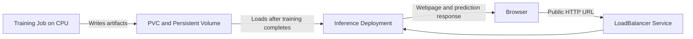

# Homework 4 Implementation Plan

## 1. Objective and scope

Build a CPU-only MNIST classification service on Google Kubernetes Engine (GKE). A Kubernetes Job trains a model and saves it to persistent storage. A separate inference Deployment loads that model and exposes a webpage through a public Kubernetes Service. The user selects an MNIST test image by ID and sees the image and prediction.

This document is an implementation plan, not a record of completed work. Checkboxes must only be marked after their completion criteria have been verified.

### Agreed scope after plan review

Keep this an assignment-sized implementation: CPU MNIST, image-ID input, a simple FastAPI webpage, two containers, one PVC, and one inference replica. Prioritize a working, explainable end-to-end demonstration. Report work is deferred for now; its submission requirements remain listed for later.

Verification consists of one small smoke-test script, reference predictions from the actual trained artifact, and one Pod-replacement experiment. A separate liveness-failure experiment is optional. Use successful training completion, required-file checks, successful loading, and a model version to verify artifacts. Checksum manifests, automatic rollback, and production availability features are outside scope. If training fails, rerun it successfully before starting inference.

### Assignment requirements from the supplied screenshot

- Training program, training Dockerfile, and training Job YAML.
- Inference program, inference Dockerfile, Service YAML, and Deployment YAML.
- Persistent storage and loading of the trained model.
- A hosted URL supporting user interaction with the inference engine.
- Google Cloud deployment without GPUs.
- MNIST is sufficient; a more complicated model is optional.
- Source code and files created or modified by the student: 40 points.
- Report of fewer than five pages: 60 points.
- Report must cover implementation steps, workflow, observations, relevant course concepts, explanations, input/output screenshots, issues, self-healing, frontend/backend integration, and citations.

### Recommended design choices

These are project decisions, not additional instructor requirements:

- Python and CPU-only PyTorch for a small MNIST neural network.
- FastAPI for inference and static webpage delivery.
- Plain HTML, CSS, and JavaScript for the interface.
- Separate training and inference images stored in Artifact Registry.
- One persistent volume claim (PVC), backed by a GKE-supported disk.
- Training and inference use the disk sequentially.
- One inference replica and a `Recreate` Deployment update strategy.
- A `LoadBalancer` Service exposing HTTP for the assignment demonstration.
- A four-page report, including references unless the instructor specifies otherwise.

## 2. Architecture and execution order



The training Job must finish successfully before inference starts. The model is stored outside container filesystems and is not baked into the inference image. The inference process loads the model once at startup and never trains during an HTTP request.

`ReadWriteOnce` means read-write mounting by one node, not universally one Pod. Do not assume multiple nodes can attach the disk simultaneously. A single replica and sequential training/inference reduce attachment conflicts. A zonal disk also constrains where replacement Pods can run. This design demonstrates persistence and recovery, but does not provide uninterrupted availability or cross-zone disaster recovery.

### Dependency sequence

```text
01 Requirements and setup
 -> 02 Shared model and artifact contract
 -> 03 Local training
 -> 04 Inference API
 -> 05 Web interface
 -> 06 Container integration
 -> 07 Google Cloud preparation
 -> 08 Kubernetes manifests
 -> 09 Cloud training and deployment
 -> 10 Recovery and acceptance checks
 -> 11 Report and submission
 -> 12 Cleanup after the required availability period
```

Collect evidence and troubleshooting notes during every step; do not defer them until report writing.

Local execution passed in Windows Python, Docker, and Minikube. GKE ran the CPU training Job, bound the model claim, and exposed the inference Deployment. The public smoke test matched the saved cloud model. [Local and GKE evidence](evidence/measurements.md)

## 3. Proposed repository structure

```text
cloudhw4/
├── ASSIGNMENT_PLAN.md
├── README.md
├── .gitignore
├── .dockerignore
├── common/
│   ├── __init__.py
│   └── model.py
├── training/
│   ├── train.py
│   ├── requirements.txt
│   └── Dockerfile
├── inference/
│   ├── app.py
│   ├── requirements.txt
│   ├── Dockerfile
│   └── static/
│       ├── index.html
│       ├── app.js
│       └── style.css
├── k8s/
│   ├── namespace.yaml
│   ├── pvc.yaml
│   ├── training-job.yaml
│   ├── inference-deployment.yaml
│   └── inference-service.yaml
├── scripts/
│   └── smoke_test.py
├── evidence/
│   ├── measurements.md
│   └── troubleshooting.md
└── report/
    └── report.pdf
```

The report PDF and evidence files are outputs to create later. Exclude downloaded datasets, local model artifacts, virtual environments, caches, and credentials from source control. Both Docker builds should use the repository root as their build context so they can copy `common/`.

## 4. Detailed tasks

### Step 01 — Confirm requirements and prepare the workspace

**Depends on:** Nothing.

- [x] **01.1 Record submission constraints.** Record the deadline, upload format, and any course-specific cloud restrictions available in the course materials. Verify whether the public URL must remain available during grading. Treat unknown details as open questions rather than invented requirements.
- [x] **01.2 Check the development environment.** Verify Python, Docker, Google Cloud CLI, `kubectl`, and the GKE authentication plugin are available. Record relevant versions. If local Docker is unavailable, choose a documented cloud build workflow before the container step.
- [x] **01.2a Check cloud feasibility early.** Confirm access to an eligible Google Cloud project, billing or course credits, required permissions, and relevant quotas before substantial implementation. Record any course restrictions. Resource creation remains in Step 07.
- [x] **01.3 Create the directory structure.** Create the source, manifest, evidence, and report directories shown above.
- [x] **01.4 Create exclusions.** Add `.gitignore` and `.dockerignore` entries for credentials, datasets, model outputs, environments, and caches. Do not copy credentials into images.
- [x] **01.5 Start the README and evidence log.** Add sections for prerequisites, configuration, local execution, cloud deployment, verification, and cleanup. Start a table for measured accuracy, training time, recovery time, and model version.

**Deliverables:** Repository skeleton, README outline, evidence logs, recorded prerequisites.

**Completion gate:** Every screenshot requirement maps to a planned artifact; the environment has a feasible way to build images and access GKE.

### Step 02 — Define the model and artifact contract

**Depends on:** Step 01.

- [x] **02.1 Define the model architecture.** Implement a small neural network in `common/model.py` that accepts normalized MNIST images and produces ten class logits. Keep training and inference on the same architecture.
- [x] **02.2 Define preprocessing.** Specify input shape, pixel scaling, normalization constants, and data type. Reuse the same transformation in training and inference.
- [x] **02.3 Define saved artifacts.** Use `model.pt` for weights, `metadata.json` for configuration and results, and `mnist-test.npz` for raw test images and labels. Store them beneath a configurable `MODEL_DIR` such as `/models`.
- [x] **02.4 Define metadata fields.** Include model version, architecture identifier, seed, epochs, batch size, normalization, test accuracy, training duration, and dependency versions.
- [x] **02.5 Define API input/output.** Prediction input is an integer `image_id` from 0 through 9999. Output includes image ID, predicted digit, actual digit, model version, and optionally the highest softmax score. Describe that score as a model score, not guaranteed correctness.

**Deliverables:** Shared model code and a documented artifact/API contract in the README.

**Completion gate:** Training and inference agree on all filenames, shapes, preprocessing rules, and version fields.

### Step 03 — Implement and validate local training

**Depends on:** Step 02.

- [x] **03.1 Load MNIST.** Download the official MNIST split through the selected library. Train only on the training split and evaluate on the test split. Keep test labels out of model inputs.
- [x] **03.2 Implement CPU training.** Explicitly select CPU, set a seed, and expose epochs, batch size, learning rate, and output directory through arguments or environment variables. Start with a small number of epochs.
- [x] **03.3 Implement evaluation.** Run evaluation without gradient tracking and calculate correct predictions divided by total test examples. Log the sample count and accuracy.
- [x] **03.4 Save artifacts safely.** Save model weights to a temporary file and rename after success. Write the matching metadata and test dataset. Fail the training process if required artifacts cannot be saved.
- [x] **03.4a Keep failed runs simple.** A failed run must not be followed by starting inference. Rerun training to completion, overwriting all required artifacts, and verify that the files exist and load successfully. Record the model version; no checksum manifest or automatic rollback is needed.
- [x] **03.5 Verify independent loading.** Start a fresh process, instantiate the model, load the saved weights on CPU, and predict several test samples without retraining.
- [x] **03.6 Record results.** Save training logs and measured duration/accuracy. An initial target of at least 95% accuracy is a project goal, not a rubric requirement; investigate substantially weaker results before increasing complexity.

**Deliverables:** `training/train.py`, pinned training dependencies, saved local artifacts, measured results.

**Completion gate:** Training exits successfully and a fresh process can use the saved model. No GPU is required.

### Step 04 — Implement the inference API

**Depends on:** Step 03.

- [x] **04.1 Load artifacts during startup.** Read the model, metadata, and sample dataset from `MODEL_DIR`; use evaluation mode and disable gradients for predictions. Log the model version and resolved artifact location.
- [x] **04.2 Implement `POST /predict`.** Validate integer IDs and bounds, fetch the selected image, apply the agreed preprocessing, and return the agreed JSON response. Invalid requests must return an appropriate 4xx response.
- [x] **04.3 Implement `GET /sample/{id}`.** Return a viewable image for the same test ID used by prediction. Ensure the displayed image and classified image correspond.
- [x] **04.4 Implement `GET /healthz`.** Return a lightweight process-health response. Avoid expensive model inference in the liveness endpoint.
- [x] **04.5 Implement `GET /readyz`.** Return success only after the model and required dataset have loaded. Missing or incompatible artifacts must prevent readiness and produce clear logs; never silently serve an untrained model.
- [x] **04.6 Verify the contract.** Exercise valid boundary IDs, a typical valid ID, negative/out-of-range IDs, and malformed input. Check that the actual label is only used for display/comparison.
- [x] **04.7 Create the smoke test.** Implement `scripts/smoke_test.py` with a configurable base URL. Require HTTP 200 and the expected response fields for IDs `0`, `42`, and `9999`. Require HTTP 422 for IDs `-1` and `10000`, a missing ID, and non-integer values such as `1.5` or `"abc"`. Use strict integer validation. Run the same script locally and against the public URL.

**Deliverables:** `inference/app.py`, pinned inference dependencies, API verification results.

**Completion gate:** A fresh server loads persisted artifacts and returns valid predictions without downloading data or training at request time.

### Step 05 — Build and connect the webpage

**Depends on:** Step 04.

- [x] **05.1 Create the page.** Add an image-ID input, Predict button, image preview, predicted digit, actual label, model version, loading indicator, and error area.
- [x] **05.2 Connect JavaScript to the API.** Send the selected ID to `/predict` and load `/sample/{id}`. Use relative URLs so the same page works locally and through the cloud address.
- [x] **05.3 Handle interaction states.** Disable duplicate submissions while a request is pending, replace stale results after a new submission, and show readable validation/network errors.
- [x] **05.4 Serve assets through FastAPI.** Make `GET /` return the page and expose its CSS/JavaScript from the same origin.
- [x] **05.5 Verify browser behavior.** Submit several different IDs and an invalid value. Confirm real backend requests drive the displayed results. Save a preliminary screenshot.

**Deliverables:** HTML, CSS, JavaScript, working browser-to-backend interaction.

**Completion gate:** A user can obtain and understand a prediction entirely through the webpage.

### Step 06 — Build and verify both containers

**Depends on:** Steps 03–05.

- [x] **06.1 Create the training Dockerfile.** Install pinned CPU-compatible dependencies, copy shared/training code, and run the trainer as the main process. Its successful exit must reflect training and artifact-save completion.
- [x] **06.2 Create the inference Dockerfile.** Install dependencies, copy shared/API/frontend code, and start the server on `0.0.0.0` at the documented container port.
- [x] **06.3 Build both images.** Build from the repository root and choose a platform compatible with the intended GKE nodes. Do not include local trained models in either image.
- [x] **06.4 Test the storage handoff.** Run training with a named Docker volume mounted at `/models`. After training exits, run inference with the same volume mounted read-only.
- [x] **06.5 Test recreation.** Remove and recreate only the inference container, reusing the volume. Confirm the same model version and predictions without rerunning training.
- [x] **06.6 Record reproducible commands.** Add exact build/run commands and expected results to the README.

**Deliverables:** Two Dockerfiles, two verified images, documented local integration workflow.

**Completion gate:** The complete train → persist → load → predict flow works in containers, including inference-container recreation.

### Step 07 — Prepare Google Cloud

**Depends on:** Step 06; project access and feasibility checks are required in Step 01.

- [x] **07.1 Select cloud configuration.** Record project ID, region, zone if applicable, cluster name, namespace, repository name, and image tags. Prefer course-provided resources when available.
- [x] **07.2 Prepare project services.** Verify billing/project access and enable the required GKE, Compute Engine, and Artifact Registry services. Enable Cloud Build only if using it.
- [x] **07.3 Create or select the cluster.** Use CPU nodes only. For a new small demonstration cluster, select a modest configuration with room for system workloads and the measured application requirements. Verify quotas and available storage classes.
- [x] **07.4 Configure access.** Obtain cluster credentials and verify the intended context before applying manifests. Confirm `kubectl` can inspect nodes and namespaces.
- [x] **07.5 Prepare Artifact Registry.** Create/select a Docker repository and configure the build environment to push images. Ensure the cluster's image-pulling identity can read the repository.
- [x] **07.6 Push versioned images.** Push explicit release tags such as `v1`; record full image paths and preferably digests. Avoid mutable `latest` references in the submitted deployment.
- [x] **07.7 Record resource ownership.** List resources created for the assignment to support later cleanup. Set an appropriate budget alert, recognizing it is not a spending cap.

**Deliverables:** Accessible GKE cluster, registry images, recorded cloud configuration.

**Completion gate:** Cluster access works, images exist in the registry, and the cluster has a supported persistent-disk storage class.

### Step 08 — Write Kubernetes manifests

**Depends on:** Step 07.

- [x] **08.1 Create `namespace.yaml`.** Use a dedicated namespace and apply it consistently to all namespaced resources.
- [x] **08.2 Create `pvc.yaml`.** Request sufficient storage using a verified StorageClass and `ReadWriteOnce`. A small request such as 5 GiB is a starting point only if supported. Record the provisioner's minimum allocation and reclaim policy. Dynamic provisioning normally eliminates the need for a handwritten PV manifest.
- [x] **08.3 Create `training-job.yaml`.** Configure one completion, one worker, a finite retry limit, CPU/memory requests and limits, the training image, and a writable PVC mount. Choose resources based on local observations; do not request GPUs.
- [x] **08.4 Create `inference-deployment.yaml`.** Configure one replica, `Recreate`, the inference image, matching labels, port, environment variables, resource requests/limits, and a read-only model volume mount.
- [x] **08.5 Configure probes.** Add startup, readiness, and liveness HTTP probes. Allow sufficient startup time for loading artifacts. Readiness checks `/readyz`; liveness checks `/healthz`. Choose thresholds based on observed startup behavior.
- [x] **08.6 Create `inference-service.yaml`.** Use `type: LoadBalancer`, expose HTTP, and map its target port to the server port. Ensure the selector exactly matches the inference Pod labels.
- [x] **08.7 Validate manifests.** Check syntax and run server-side dry-run validation against the selected cluster after creating the namespace. Resolve unsupported fields and configuration errors before starting workloads.

**Deliverables:** All five YAML files, documented resource and probe choices.

**Completion gate:** Manifests validate and reference the same namespace, PVC, image paths, labels, ports, and artifact directory consistently.

### Step 09 — Execute cloud training and publish inference

**Depends on:** Step 08.

- [x] **09.1 Apply the namespace and PVC.** Inspect claim status and events. A claim using `WaitForFirstConsumer` may remain Pending until a consuming Pod is scheduled; do not require binding before creating the Job.
- [x] **09.2 Run the training Job.** Apply the Job, watch scheduling and logs, and wait for successful completion with a bounded timeout. Diagnose failures before proceeding.
- [x] **09.3 Capture training evidence.** Save Job status, logs, training duration, test accuracy, model version, and PVC/PV information before deleting any completed resources.
- [x] **09.4 Start inference.** Only after training completes, apply the Deployment. Inspect logs and wait for readiness. Confirm it loads the expected model version from `/models`.
- [x] **09.5 Expose the service.** Apply the Service, wait for an external address, and open the HTTP URL from the browser without port forwarding.
- [x] **09.6 Verify public predictions.** After cloud training saves its artifacts, reload those saved weights in the training process and record reference predictions for IDs `0`, `42`, and `9999`, along with the model version. Run the smoke test against the public URL and compare its predicted digits and model version with those references. No model download is required. Save a screenshot with URL, input, image, and output visible.
- [x] **09.7 Record the operational sequence.** Put the exact successful commands in the README, including how to create a new training Job for a future run. For retraining with this design, stop inference first, complete training, and restart inference afterward.

The public HTTP smoke test passed without port forwarding. Chrome displayed test image `42` and predicted digit `4` at the public address. [Public smoke test](evidence/gke-smoke.log) · [Browser screenshot](evidence/gke-browser.jpg)

**Deliverables:** Completed cloud training Job, ready inference Deployment, public URL, cloud evidence.

**Completion gate:** The public webpage performs inference using the model produced by the cloud training Job.

### Step 10 — Verify persistence, recovery, and error handling

**Depends on:** Step 09.

- [x] **10.1 Establish a baseline.** Record a successful prediction, model version, current Pod name/UID, and timestamp. Record the model artifact checksum if practical.
- [x] **10.2 Trigger Pod replacement.** Delete only the inference Pod while preserving the Deployment, Service, and PVC. Watch for a replacement Pod and record its new name/UID.
- [x] **10.3 Verify recovered service.** Wait for readiness and repeat the same prediction through the same public URL. Confirm the same model version and result without retraining. Measure time to readiness and observed request failure duration separately if collecting both.
- [x] **10.4 Explain the recovery mechanism accurately.** The Deployment/ReplicaSet restores the desired Pod count. Container restart behavior and liveness probes address container failures. Readiness controls traffic eligibility. The PVC preserves artifacts across Pod replacement.
- [x] **10.5 Verify invalid-input behavior.** Check negative, out-of-range, and malformed inputs through the API and confirm the UI presents useful errors.
- [x] **10.6 Verify missing-artifact behavior locally.** Start inference with an empty test volume and confirm startup/readiness fails clearly. Do not delete the working cloud model to perform this check.
- [x] **10.7 Document limits.** State that one replica can experience downtime during replacement or updates, and this test does not prove liveness-triggered restarts, node-failure recovery, or cross-zone resilience.

A separate controlled liveness-failure experiment is optional and is not part of this step's completion gate.

The replacement Pod was observed ready 16.90 seconds after the delete request. The original training Job, model checksum, and public prediction results matched across the replacement. [Recovery measurements](evidence/measurements.md#gke-pod-replacement) · [Before-and-after log](evidence/gke-recovery.log)

**Deliverables:** Before/after evidence, recovery measurements, acceptance results, accurate self-healing explanation.

**Completion gate:** The replacement Pod serves the existing model through the unchanged Service URL, and failure cases do not return misleading successful predictions.

### Step 11 — Write the report and package the submission

**Deferred for now.** Resume this step after implementation and verification; early report drafting is not part of the current work. Retain lightweight logs and screenshots during implementation so later reporting can use actual evidence.

**Depends on:** Step 10; collect notes throughout earlier steps.

- [ ] **11.1 Draft page 1: purpose and architecture.** Explain the user workflow, diagram, selected components, and mapping to course concepts.
- [ ] **11.2 Draft page 2: implementation.** Describe training, evaluation, artifact persistence, model loading, containers, and frontend/API integration. Include key implementation decisions rather than full source listings.
- [ ] **11.3 Draft page 3: deployment and results.** Summarize the cloud deployment sequence, measured results, and readable screenshots of real user input/output.
- [ ] **11.4 Draft page 4: recovery and discussion.** Describe the recovery experiment, observations, actual issues and fixes, limitations, and references. Keep the total below five pages.
- [ ] **11.5 Attribute sources.** Cite documentation, dataset/model sources, and borrowed or adapted code. Identify what was implemented or modified personally. Follow any course-specific AI-use policy if one exists.
- [ ] **11.6 Complete reproducibility instructions.** Ensure the README includes prerequisites, configuration placeholders, build/push commands, deployment order, URL discovery, checks, retraining procedure, and cleanup.
- [ ] **11.7 Review the source package.** Include required code, Dockerfiles, manifests, and explanations. Exclude secrets, environments, caches, and unnecessary large generated files. Include model binaries only if the submission rules request them.
- [ ] **11.8 Review the final PDF.** Confirm page count, readable figures, visible input/output examples, working references, and consistency between reported measurements and evidence.

**Deliverables:** Submission source package, complete README, report PDF under five pages.

**Completion gate:** Every rubric requirement is traceable to a file or report passage; no results are presented as measured without evidence.

### Step 12 — Clean up after the required availability period

**Depends on:** Submission/demo completion and confirmation that the endpoint is no longer needed for grading.

- [ ] **12.1 Preserve evidence.** Save final logs, screenshots, measurements, report, and any model artifacts needed for future reproduction.
- [ ] **12.2 Remove assignment workloads.** Delete the Service and workloads when no longer needed. Check that load-balancer resources are released.
- [ ] **12.3 Handle storage deliberately.** Inspect the PV reclaim policy before deleting claims. Delete disks only when their contents are no longer needed; verify whether underlying disks remain afterward.
- [ ] **12.4 Remove dedicated infrastructure.** Delete a cluster or registry repository only if it was created solely for this assignment and is no longer needed. Preserve shared course resources.
- [ ] **12.5 Check remaining resources.** Inspect disks, external addresses, load balancers, images, and other project resources for unintended leftovers.

**Deliverables:** Preserved submission evidence and a cleanup record.

**Completion gate:** No unnecessary assignment-specific resources remain, and required grading access was not removed prematurely.

## 5. Acceptance checklist

| ID | Check | Passing evidence |
|---|---|---|
| A1 | CPU-only training works | Successful training logs and no GPU resource requests |
| A2 | Cloud training is a Kubernetes Job | Completed Job status |
| A3 | Artifacts persist outside containers | Bound PVC/PV and recorded artifact location |
| A4 | Inference loads the trained artifact | Startup log with matching model version |
| A5 | Frontend calls the backend | Real browser prediction and API response |
| A6 | Service is publicly reachable | Browser screenshot showing the external URL |
| A7 | Invalid input is handled | Expected 4xx response and useful UI message |
| A8 | Pod replacement preserves inference | Different Pod UID, same model version and prediction |
| A9 | Self-healing is explained accurately | Report distinguishes replacement, restarts, and readiness |
| A10 | Required source files are included | Training/inference code, both Dockerfiles, all required YAML |
| A11 | Report satisfies format and evidence requirements | Fewer than five pages, screenshots, observations, issues, citations |
| A12 | Another reader can reproduce the workflow | Complete README with verified commands |

## 6. Evidence and troubleshooting templates

Record measurements in `evidence/measurements.md`:

| Measurement | Value | How measured | Evidence file |
|---|---|---|---|
| Model version | To measure | Saved metadata | To capture |
| Test accuracy | To measure | Correct / total test samples | To capture |
| Training duration | To measure | Timed training run | To capture |
| Inference startup duration | To measure | Startup logs and readiness | To capture |
| Pod replacement recovery time | To measure | Deletion to replacement readiness | To capture |

For each real issue, record:

```text
Symptom:
Relevant logs/events:
Root cause:
Change made:
Verification:
Related course concept:
```

Common diagnostic starting points:

| Symptom | First checks |
|---|---|
| ImagePullBackOff | Full image path, tag existence, registry read permission |
| PVC Pending | StorageClass, delayed binding, consumer scheduling, events |
| Disk multi-attach error | Overlapping training/inference Pods, old attachment, scheduling |
| Pod Pending | CPU/memory requests, quota, node capacity, volume topology |
| OOMKilled | Actual memory use, limits, model/data loading behavior |
| Service reachable but no application response | Selectors, readiness, server bind address, target port |
| Model loading failure | File paths, shared architecture, dependencies, artifact compatibility |
| Poor predictions | Normalization, tensor shape, evaluation mode, training quality |

## 7. Suggested work blocks

| Block | Steps | Required milestone |
|---|---|---|
| 1 | 01–03 | Saved model can be loaded independently |
| 2 | 04–06 | Browser inference and container persistence work locally |
| 3 | 07–09 | Cloud-trained model is usable through a public URL |
| 4 | 10–11 | Recovery evidence, report, and submission package are complete |
| Later | 12 | Resources cleaned up after grading needs are met |

Reserve extra time for cloud access, quota, scheduling, and storage troubleshooting. Prioritize the required workflow and report over optional features such as drawing input, image uploads, autoscaling, multiple replicas, custom domains, or a larger model.

## 8. Reference documentation

- [GKE persistent volumes and provisioning](https://docs.cloud.google.com/kubernetes-engine/docs/concepts/persistent-volumes): PVCs, PVs, storage classes, access modes, and disk constraints.
- [Kubernetes Jobs](https://kubernetes.io/docs/concepts/workloads/controllers/job/): finite training workloads and completion/retry behavior.
- [Kubernetes Deployments](https://kubernetes.io/docs/concepts/workloads/controllers/deployment/): desired replica count and update strategies.
- [Kubernetes startup, readiness, and liveness probes](https://kubernetes.io/docs/tasks/configure-pod-container/configure-liveness-readiness-startup-probes/): health checks and their distinct effects.
- [Kubernetes self-healing](https://kubernetes.io/docs/concepts/architecture/self-healing/): recovery concepts for the discussion.

Add the exact dataset, library, and adapted-code references used during implementation to the final report.
